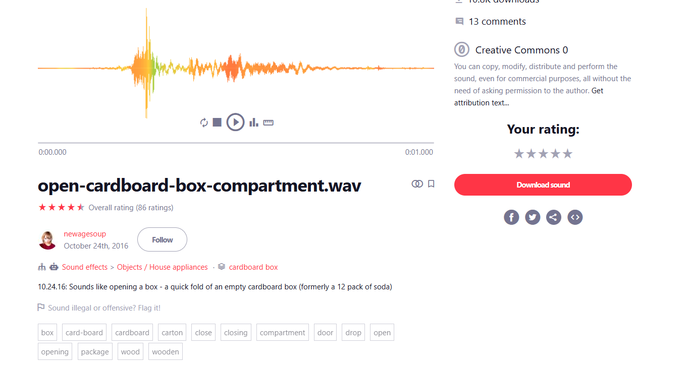

Fantozzis Footsteps
https://opengameart.org/content/fantozzis-footsteps-grasssand-stone

Licence: Creative Commons 0 (CC0)
Edit: Dylan Took a snip of it and chopped the rest off for looping when moving the player

---

Michel Baradari
https://opengameart.org/content/chaingun-pistol-rifle-shotgun-shots

Licence: CC-BY 3.0  - https://creativecommons.org/licenses/by/3.0/
Edits: Dylan Chopped each emphisized shot into a tiny clip to make realistic gun shots when triggered.

---
Cardboard Box
Author: newagesoup
link: https://freesound.org/people/newagesoup/sounds/364740/

licence: Creative Commons 0 (CC0)
Edits: None

---
oh sh-t by xtrgamr
licence: Creative Commons 4 (CC4) - have to attribute
link: https://freesound.org/people/xtrgamr/sounds/278895/
---
Dylan Austin
AntSoldierGameMastered.wav

Licence: Rights reserved for the time being (bloody good tune)
Edits: Produced with bandlab, and mastered with bandlab online mastering