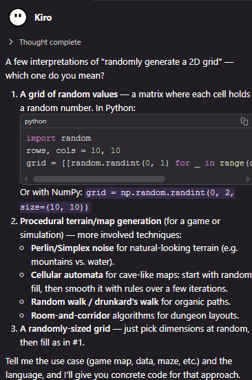
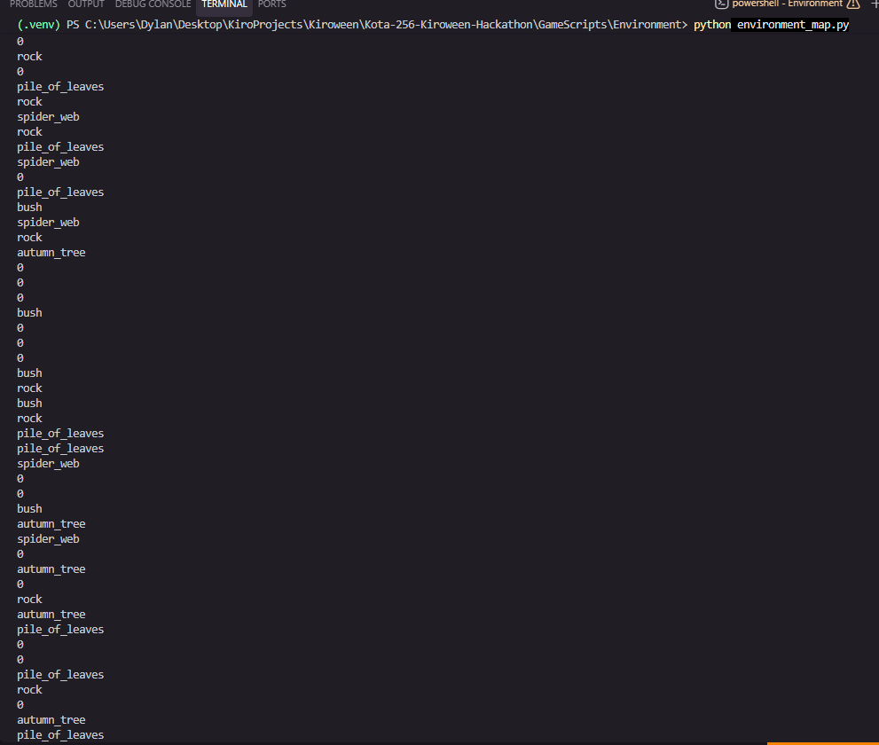
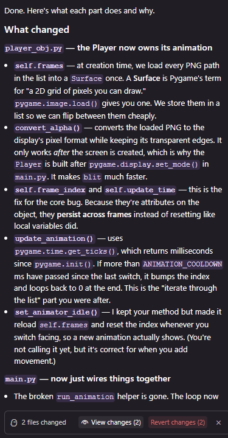
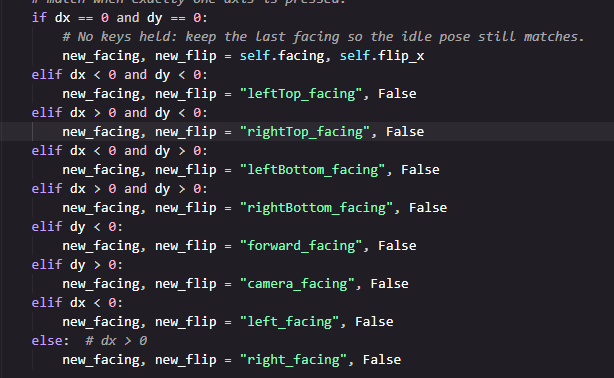
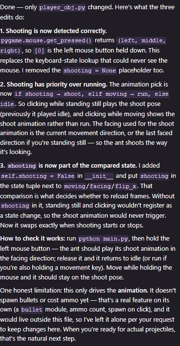
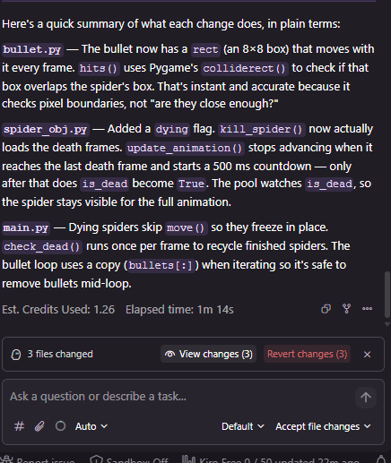
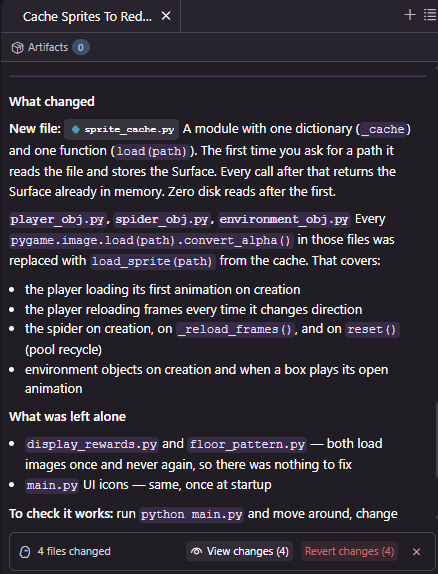

# Dylan's Documentation

### First appearance

- As soon as I came into the project I downgraded python, set up venv and installed pygame.
- For the second task, I read main.py and give it a quick run
- On the third task I set up my Dylan files, and within these files are folders for my docs, artwork and animation controller scripts. 
- Lastly, I also made a 'Gamescripts' folder for shared development. it starts with a world_builder.py and a simple function. I feel that the world_builder.py is a good place for describing levels as opposed to using main.py for everything.

---

### Making an environment map grid with Kiro Free

---

### How the Environment grid map is coming out so far

---

### Recently Acquired an asset pack
- Cardboard Boxes by DANI MACCARI
- I took one cardboard box and animated the box as if it was opening
- I used a lightweight pixel art studio known as 'Piskel'

### Alongside finding asset packs
- I created my own ant character with idle and run animations

---

# Back to Kiro
### I had some help from free Kiro AI to help me with animations.
- It shows an explanation of why my method was not working, and the AI put my code on the Player class instead.
- The first animation implementation is working in main.py

### When developing 8 directions worth of spites
- I had to ask Kiro to implement animation triggers depending upon 8 different directions. I did not know how Kiro implementing the animation triggers so I ask for help. 
- Below is Kiro's implementation

### I also had kiro help implement the shoot function
- This only triggers the animation it doesn't include actual shooting logic just yet

---

### Wholesome notes
17/11/2026
- I have set the foundations for the spider class for Hana to look at. I have made it similar to the player class in how it functions in regards to triggering animations and handling directions.
- I have suggested Hana look at shooting, spider AI, improving the player, UI, health and ammo for both player and spider, look into loot boxes.
- I have some pressing matters with the map, boundaries, isometric tiles (potentially because it will improve the look of our game), sound effects, music and anywhere else I can support the cause.

---

### Back to Kiro
- I have ran out of my free plan of Kiro and now I am having to undertake research to finish off my work.
- Last thing Kiro did was show me how to increase sizes of my sprites in environment_obj.py
- I'm out here on my own now.... I need to figure out how to implement these isometric tiles and deactivate images that aren't in the camera view.... oh my life

---

### Since My free Kiro ran out, I was getting some help from online research and other AI.
- ESPECIALLY, for detecting boundaries (though I was right in implementing is boundary to objects on all 4 sides of the tile map grid), AI gave me code for detecting the rectangular collision of objects in the boundaries list. 

---

### Making of the spider AI, death and Bullet collision
- I initially had chatGPT help with using the right code to get collisions working, spiders spawning, and spiders moving. I set up a lot of the foundations in the classes, as well as the poolsystem and how the pool system connects to the y-sorted camera groups etc etc.

- However I couldn't understand how to make the spiders die and why bullet collisions were not responsive in the right way, and Kiro managed to wire it better

### I heard about sprite / animation caching to save performance
- I did not full understand how to implement this and the project architecture has already become quite large
- a quick Kiro prompt resolved this issue for how the player and spiders read and call animations. The scripts now no longer read images from disk every time animations change
