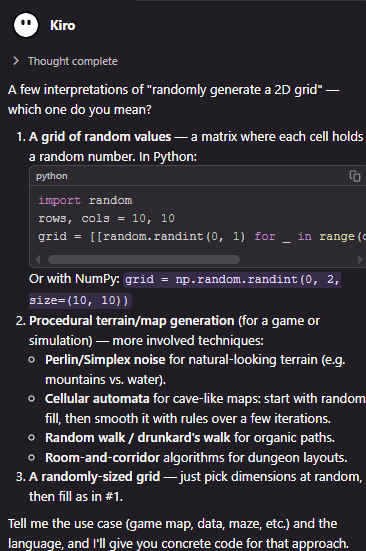
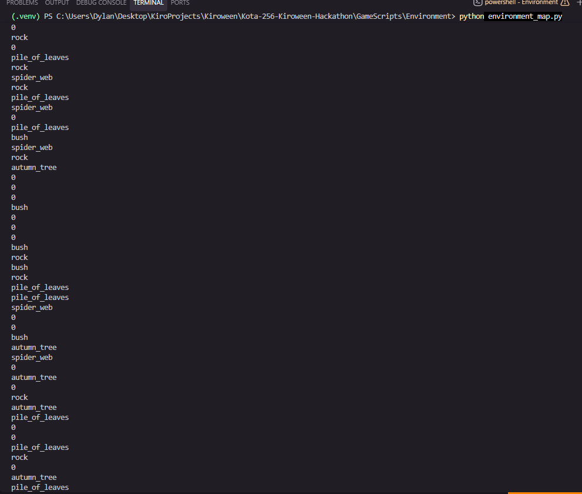
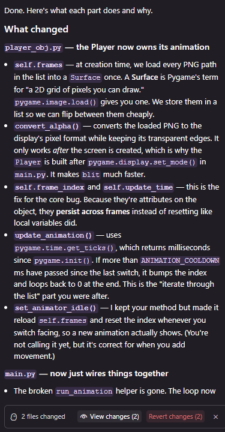

# Dylan's Documentation

### First appearance

- As soon as I came into the project I downgraded python, set up venv and installed pygame.
- For the second task, I read main.py and give it a quick run
- On the third task I set up my Dylan files, and within these files are folders for my docs, artwork and animation controller scripts. 
- Lastly, I also made a 'Gamescripts' folder for shared development. it starts with a world_builder.py and a simple function. I feel that the world_builder.py is a good place for describing levels as opposed to using main.py for everything.

---

### Making an environment map grid with Kiro Free

---

### How the Environment grid map is coming out so far

---

### Recently Acquired an asset pack
- Cardboard Boxes by DANI MACCARI
- I took one cardboard box and animated the box as if it was opening
- I used a lightweight pixel art studio known as 'Piskel'

### Alongside finding asset packs
- I created my own ant character with idle and run animations

---

# Back to Kiro
### I had some help from free Kiro AI to help me with animations.
- It shows an explanation of why my method was not working, and the AI put my code on the Player class instead.
- The first animation implementation is working in main.py
